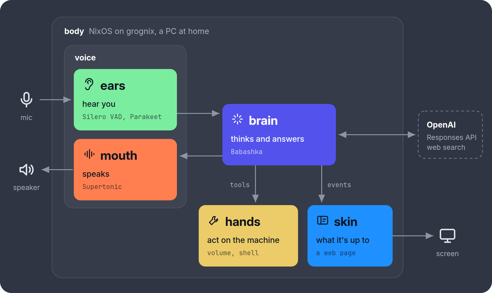

# grog

Grog is an AI home assistant, think of it as a smarter Alexa.
You connect it to your AI provider and install it in a separated machine with optional voice/sound support.

> **You:** Grog, will it rain tomorrow?<br>
> **grog:** Probably not. 10% chance in São Paulo, with a high of 27.


## How it works



| Part                           | What it is                                                                                 | Made with                    |
|--------------------------------|--------------------------------------------------------------------------------------------|------------------------------|
| [brain](brain/README.md)       | The core, the server that answers, and the `grog` CLI                                      | Babashka                     |
| [voice](voice/README.md)       | Its ears and mouth: hears its name, turns speech into text and the answer back into speech | Python, Parakeet, Supertonic |
| [skin](skin/README.md)         | A page, fullscreen on its screen, showing what it's up to                                  | HTML, CSS, JS                |
| [hands](brain/README.md#hands) | Runs things on the machine for the brain, which is sandboxed                               | Babashka                     |
| [body](body/README.md)         | What it runs on: a NixOS module, a PC set up just for grog                                 | Nix                          |

## Running it

### On a PC of its own

Boot the PC into the NixOS installer, then from any machine with Nix:

```sh
nix run github:ericdallo/grog#install -- nixos@<its address>
```

This erases one of its disks. See [installing](body/README.md#installing).

### Just the brain

```sh
cd brain
OPENAI_API_KEY=... bb serve
bb chat
```

## Using it

Talk to it ("Grog, ..."), touch its screen (its face, or its actions), or use
the CLI:

```sh
grog chat
grog ask "Will it rain tomorrow?"
grog status    # model, account, and what it has spent
grog login     # sign in with a ChatGPT subscription: a code, on any phone or computer
grog update    # to the latest grog pushed (also by asking it, or on its screen)
```

Without a subscription, put an OpenAI API key in `OPENAI_API_KEY` (on NixOS,
in `/etc/grog/secrets.env`). See [paying for it](brain/README.md#paying-for-it).

## Privacy

- Nothing it hears is recorded, and the logs never have what was said.
- Its mic can be switched off: ask it to stop listening, or use its screen
  or `grog mic off`. It stays off, even after restarts, until switched on.
- Speech to text runs on the machine. Only what's said to grog goes to OpenAI, as text.
- The screen only shows what's said with `skin.captions`, off by default but on in grognix.

More in [security](brain/README.md#security).

## Development

```sh
nix develop    # bb, clj-kondo, python3, ruff, node, shellcheck
make test
make lint
make check     # builds the packages with Nix, running the tests
make check-vm  # boots VMs with the NixOS module and grognix
```

## License

[Apache 2.0](LICENSE)
